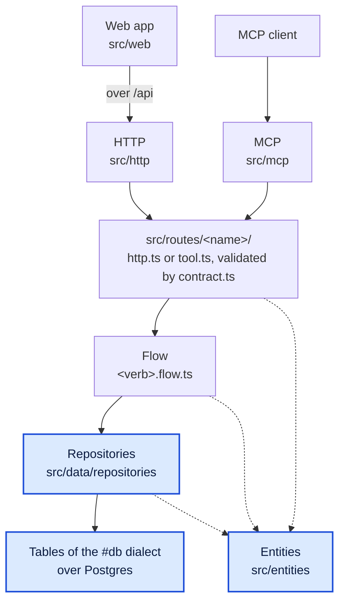
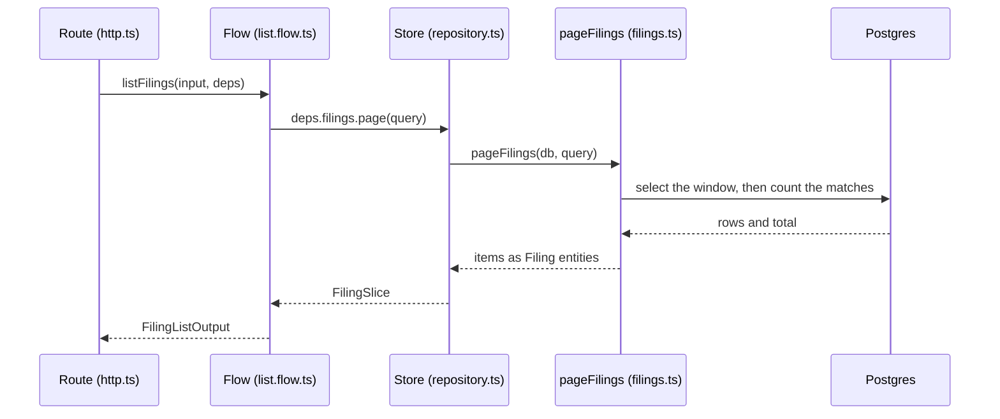
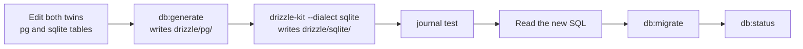

# Data layer

This page covers the data layer: the entities every layer shares, the repositories that query
the database, the tables of each dialect, and the migrations and seeds that build and fill the
schema. It is one of three architecture pages. [Service layer](service.md) covers the routes,
flows and contracts above this layer, and [Web app](web.md) covers the React app. The backend
map in [`CLAUDE.md`](../../CLAUDE.md) says where each file goes, and [Database](../database.md)
is the operating guide, with setup and troubleshooting.

The map shows every layer, with the data layer's three parts highlighted. Solid arrows are
calls, and dotted arrows mean "imports the entity schemas".



## What the data layer does

The data layer stores the service's rows and reads them back as entities. It knows nothing of
HTTP, MCP or requests: a function here takes a database handle and plain arguments, and answers
plain data. So the layers above never see a database row, and this layer never sees a request.

The queries are written with [drizzle](https://orm.drizzle.team), a TypeScript query builder
whose tables are plain objects. The table lists the layer's parts, each with its concern and
what it imports.

| Part | Where | Concern | Imports |
| --- | --- | --- | --- |
| Entities | `src/entities/` | The domain shapes, as zod schemas and their types | `zod` and other entities only |
| Repositories | `src/data/repositories/` | The drizzle queries, and the mapping between rows and entities | entities, `src/data/active.ts`, `drizzle-orm` |
| Active dialect | `src/data/active.ts` | Re-exports the client, `transact` and the tables of the dialect `#db` names | `#db` |
| Tables | `src/data/pg/tables/`, `src/data/sqlite/tables/` | The schema, one file per area and dialect | drizzle's column builders |
| Migrations | `drizzle/pg/`, `drizzle/sqlite/` | The SQL that builds the schema, generated from the tables | nothing |

## Entities at the centre

An entity is one thing the service stores or passes around: a zod schema plus the type inferred
from it, under the same name. The service has two entity files, `src/entities/company.ts`
(`Company`, `CompanyTicker`) and `src/entities/filing.ts` (`Filing`, `FilingLinks` and the form
buckets). The smallest entity shows the pattern:

```ts
// src/entities/company.ts
export const CompanyTicker = z.strictObject({
  /** The ticker: the primary key. */
  ticker: z.string(),
  /** The CIK of the company the ticker names. */
  cik: z.number().int(),
});

/** A company ticker as {@link CompanyTicker} parses it. */
export type CompanyTicker = z.infer<typeof CompanyTicker>;
```

Because the schema and the type share a name, `CompanyTicker` is a value to parse with and a
type to annotate with. The object is strict, which means it refuses any field it does not name,
so a stray field fails the parse instead of riding along.

An entity holds no behaviour beyond pure helpers, such as `toCik10`, which pads a CIK to ten
digits, and `bucketOf`, which names the form bucket a base form counts under. It imports only
zod and other entities. So the contracts, the flows, the repositories and the web app can all
import it without pulling in anything else. [The entities README](../../src/entities/README.md)
has a sketch of a new entity.

## The active dialect

A dialect is the flavour of SQL one database speaks, and the tree carries two: Postgres and
SQLite. The `#db` entry of `imports` in `package.json` picks the active one, and it points at
Postgres:

```json
{
  "imports": {
    "#db": "./src/data/pg/index.ts"
  }
}
```

Postgres, run in Docker, is this project's required database. `bun run db:up` starts it from
`docker-compose.yaml`, and the client in `src/data/pg/client.ts` refuses to open without a
`DATABASE_URL`. SQLite stays in the tree because the template supports both dialects, and
nothing in this project loads it. The tests that need a database run on Postgres too: each test
file gets a scratch database from `tests/support/test-db.ts` (see
[the integration tests](../setup.md#the-integration-tests)).

`#db` is an import alias, and not a value in `.env`, because the type checker needs the dialect
too. Drizzle gives a Postgres table and a SQLite table different types, and a query typed for
one does not compile against the other. `package.json` is the one file that both Bun and `tsc`
read before any code runs, so the alias hands every repository one dialect's types. A value in
`.env` is read only while the code runs, which is too late for the types. `drizzle.config.ts`
cannot pick it either: only drizzle-kit reads that file, and it takes its dialect from `#db`.

| | Postgres (active) | SQLite |
| --- | --- | --- |
| `#db` target | `./src/data/pg/index.ts` | `./src/data/sqlite/index.ts` |
| Driver | postgres-js, a pool opened from `DATABASE_URL` | `bun:sqlite`, a file or `:memory:` |
| Started by | `bun run db:up`, in Docker | nothing; `bun run db:migrate` creates the file |
| Foreign keys | enforced | declared, not enforced |
| Used for | the service and the integration tests | the template's other build |

Each dialect folder's `index.ts` exports the same names: `DIALECT`, the client (`getDb`,
`closeDb`), `transact`, `dbDependency` and the tables. `src/data/active.ts` is the one module
that reads `#db`, and it re-exports that surface:

```ts
// src/data/active.ts
export { apiToken, appConfig, authSession, closeDb, companies, companyTickers, dbDependency, DIALECT, filings, getDb, transact, type DrizzleClient as ActiveClient } from '#db';
```

Every other module imports from `src/data/active.ts`, so no code names a dialect folder. The
same entry drives `drizzle.config.ts`, which picks drizzle-kit's dialect, the schema folder it
reads and the migrations folder it writes. So switching `#db` switches the client, the tables
and the migrations together, and `.claude/skills/db/reference/dialects.md` is the checklist for
a switch.

`dbDependency` is the database as a dependency of the service's chassis, the shared server
package. The chassis starts it before the server listens. On Postgres that start runs
`select 1`, so a database that is down stops the service at startup, not at the first request.

## Tables, one file per dialect

A table is declared twice, once with each dialect's column builders: in
`src/data/pg/tables/<area>.ts` and in its twin `src/data/sqlite/tables/<area>.ts`. The twins keep
the same table name, keys and column names, so one repository query runs on either. They differ
only where the two databases store a value differently, as the `filings` and `companies` twins
show:

| Column | Postgres | SQLite |
| --- | --- | --- |
| `filing_date` | `date(..., { mode: 'string' })` | `text(...)`, as `YYYY-MM-DD`, which sorts as a date |
| `is_amendment` | `boolean(...)` | `integer(..., { mode: 'boolean' })`, stored as 0 or 1 |
| `items` | `jsonb().$type<string[]>()` | `text({ mode: 'json' }).$type<string[]>()` |
| `filings_synced_at` | `timestamp(..., { withTimezone: true })` | `integer(..., { mode: 'timestamp' })` |

The Postgres `filings` table, trimmed to its keys, its indexes and the first three columns above:

```ts
// src/data/pg/tables/filings.ts
export const filings = pgTable('filings', {
  accessionNumber: text('accession_number').primaryKey(),
  cik: integer().notNull()
    .references(() => companies.cik, { onDelete: 'cascade' }),
  isAmendment: boolean('is_amendment').notNull(),
  filingDate: date('filing_date', { mode: 'string' }).notNull(),
  items: jsonb().$type<string[]>()
    .notNull()
    .default([]),
  // ... the other columns
}, (table) => [
  index('filings_cik_filing_date_idx').on(table.cik, table.filingDate.desc()),
  index('filings_cik_base_form_idx').on(table.cik, table.baseForm),
]);
```

The accession number is the primary key, so one filing is one row however often it is synced.
The foreign key from `cik` to `companies` deletes a company's filings with it, on Postgres. The
first index serves the paginated list, and the second serves the form filter and the summary.

A new table goes in both twins, then in each dialect's `index.ts` and in `src/data/active.ts`. A
table missing from `src/data/active.ts` is out of the repositories' reach. `/db add` does all of
it, as [Changing the schema](#changing-the-schema) shows.

## Repositories

A repository is a module of plain async functions over drizzle, one file per area, in
`src/data/repositories/`. Every function takes a `Db` as its first argument, which is the active
client or an open transaction on it:

```ts
// src/data/repositories/db.ts
export type Db = Pick<ActiveClient, 'select' | 'insert' | 'update' | 'delete' | 'transaction'>;
```

`Db` is a `Pick`, a type made of only the verbs a repository uses. A transaction has the same
verbs, so it fits `Db` as well as the client does, and a repository joins a caller's transaction
without knowing it is in one. The service has three repositories: `companies.ts` and
`filings.ts` for the SEC data, and `config.ts` for the settings in `app_config`.

### Rows and entities

A repository answers entities, never drizzle rows. Where a row and its entity differ, the
repository maps between them in one function each way. A filing's entity holds its five SEC
links in `links`, while the row spreads them into five URL columns. So `toRow` spreads them on
the way in, and `toFiling` gathers them back on the way out:

<!-- eslint-skip -->
```ts
// src/data/repositories/filings.ts
function toFiling(row: FilingRow): Filing {
  const { documentUrl, indexUrl, folderJsonUrl, inlineXbrlViewerUrl, rawXmlUrl, items, ...fields } = row;
  return {
    ...fields,
    items: [...items],
    links: linksOf({ documentUrl, indexUrl, folderJsonUrl, inlineXbrlViewerUrl, rawXmlUrl }),
  };
}
```

drizzle types the row from the table (`FilingRow` is `typeof filings.$inferSelect`), so the
compiler checks that the mapping builds a full `Filing`. The companies repository does the same
in `toCompany`, where the sync time is a `Date` in the row and an ISO string in the entity.

### Stores in the route folders

A route folder can hold a `repository.ts` of its own. In this service those files are stores:
thin adapters that bind `db` to the shared repository functions, one method per call the flows
make. `src/routes/filings/repository.ts` builds the filings store:

```ts
// src/routes/filings/repository.ts
export function filingStore(db: Db): FilingStore {
  return {
    page: async (query) => pageFilings(db, query),
    summary: async (query) => summarizeSelectedFilings(db, query),
  };
}
```

### Transactions

A write of several statements goes through `transact(db, body)` from `src/data/active.ts`. It
commits when `body` resolves and rolls back when `body` rejects. Called inside a running body, it
opens a savepoint, a nested transaction, so one repository can compose another. Code never calls
drizzle's `db.transaction` itself, because on SQLite that commits an async callback at its first
`await`, while `transact` rolls back on both dialects.

`insertFilings` writes a sync's filings in chunks inside one `transact`, so a refused chunk
leaves none of them stored:

```ts
// src/data/repositories/filings.ts
export async function insertFilings(db: Db, rows: readonly Filing[]): Promise<number> {
  if (rows.length === 0) return 0;
  return transact(db, async (tx) => {
    let inserted = 0;
    for (let start = 0; start < rows.length; start += INSERT_CHUNK_SIZE) {
      const chunk = rows.slice(start, start + INSERT_CHUNK_SIZE).map(toRow);
      const written = await tx.insert(filings).values(chunk)
        .onConflictDoNothing({ target: filings.accessionNumber })
        .returning({ accessionNumber: filings.accessionNumber });
      inserted += written.length;
    }
    return inserted;
  });
}
```

`onConflictDoNothing` on the accession number makes the insert safe to repeat. A re-sync
therefore stores only the filings it has not stored before, and never overwrites one.

## Who may import whom

Two local ESLint rules, registered in `eslint/plugin.mjs`, hold the layout's import boundaries.
They run in `bun run lint` and in the editor, and they report on the exact import. These are the
entries that touch the data layer:

| Rule | Applies to | Forbids |
| --- | --- | --- |
| `template/layer-imports`, entry `flow` | every `<verb>.flow.ts` | `src/data`, `#db`, `drizzle-orm`, any `repository.ts`, and the transports |
| `template/layer-imports`, entry `entity` | `src/entities/` | anything but `zod` and other entities |
| `template/no-drizzle-transaction` | everything under `src/` except `src/data/pg/transaction.ts` | any call of a member named `transaction` |

The first entry is why a flow never touches the database. The flow declares the store it needs
as an interface in its `deps`, and the route or the tool passes the store in. So the flow owns
the shape and the data layer fits it, which clean architecture calls dependency inversion. A
flow test can then pass a plain object as its store, as
`tests/routes/filings/summary.flow.test.ts` does, and needs no database.

The third entry is the one exception it names: `transact` in `src/data/pg/transaction.ts` wraps
drizzle's `transaction`, and the SQLite `transact` in `src/data/sqlite/transaction.ts` runs its
own `BEGIN` and savepoints instead. The rules live in `eslint/rules/layer-imports.mjs` and
`eslint/rules/no-drizzle-transaction.mjs`.

## Validation at each step

Each step checks what it can see from its place in the call order. Data is parsed once, at the
edge where it enters, and the database's constraints hold it in shape after that. The table
follows a filing from the request to the stored row:

| Step | Where | What it checks | On failure |
| --- | --- | --- | --- |
| Contract | `src/routes/filings/contract.ts` | The request input, with a strict zod schema | Refused before the flow runs |
| Entity at ingest | `toFiling` in `src/sec/parse.ts`; `TickerFile` in `src/data/seeds/01-companies.ts` | Each SEC row against the strict `Filing`; the ticker file against its schema | Nothing is written |
| Repository guard | `deleteFilingsBefore` in `src/data/repositories/filings.ts` | An argument only it can judge: a cutoff spelled `YYYY-MM-DD` | `RangeError`, nothing deleted |
| Row mapping | `toFiling` and `toCompany` in the repositories | That a row maps to the full entity type | `bun run typecheck` fails |
| Database | the table files, applied as migrations | Primary keys, `NOT NULL`, the unique `cik10`, foreign keys | The driver refuses, and `transact` rolls back |

The two `toFiling` functions are different. The one in `src/sec/parse.ts` turns an SEC row into
an entity and runs `Filing.parse`, and the one in the repository turns a stored row into an
entity with no parse.

A read trusts the rows it gets back, so it does not parse them with zod. The rows were parsed as
entities before they were written, the column types and constraints keep them in shape, and the
compiler checks the mapping. A second parse on every read would only cost time.

The settings in `app_config` are the exception, because a person may edit them by hand, and
SQLite stores their JSON as text with no check. So `src/data/repositories/config.ts` treats the
stored value as untrusted, and parses each backup field with `BackupSettingsSchema`. A field
that does not fit falls back to its default, and the caller's log gets a warning:

<!-- eslint-skip -->
```ts
// src/data/repositories/config.ts
function readField<K extends keyof BackupSettings>(stored: Readonly<Record<string, unknown>>, key: K): FieldReading<K> {
  if (!(key in stored)) return { value: BACKUP_DEFAULTS[key], valid: true };
  const parsed = BackupSettingsSchema.shape[key].safeParse(stored[key]);
  return parsed.success
    ? { value: parsed.data as BackupSettings[K], valid: true }
    : { value: BACKUP_DEFAULTS[key], valid: false };
}
```

SQLite declares foreign keys but does not enforce them, because its connection never turns
`PRAGMA foreign_keys` on. On that dialect a flow checks that a parent row exists where it
matters, as the Known limitations section of `.claude/skills/db/actions/add.md` says.

## Worked example: one page of filings

`GET /api/companies/:ticker/filings` answers a company and one page of its filings. The diagram
follows the filings read from the route down to Postgres and back. It leaves out the flow's
ticker lookup and its SEC sync, which the paragraphs after it cover.



`src/http/server.ts` opens the client once with `getDb()`, and each route handler receives it as
`db`. The route in `src/routes/filings/http.ts` builds the stores over `db` and calls the flow:

<!-- eslint-skip -->
```ts
// The handler of filingListRoute, in src/routes/filings/http.ts
async (input, { db, log, sec }) => listFilings(input, {
  companies: companyLookupStore(db),
  filings: filingStore(db),
  sync: syncSourcesFor(db, sec),
  log: inDomain(log, DOMAIN),
});
```

The flow, `listFilings` in `src/routes/filings/list.flow.ts`, resolves the ticker through
`deps.companies` and syncs the company from SEC when its rows are stale. Then it turns the page
number into a window and asks the filings store for it:

<!-- eslint-skip -->
```ts
// src/routes/filings/list.flow.ts
const slice = await deps.filings.page({
  cik: company.cik,
  form: input.form,
  sort: input.sort,
  offset: (page - 1) * pageSize,
  limit: pageSize,
});
```

The store calls `pageFilings(db, query)` in `src/data/repositories/filings.ts`. The repository
builds one `where` for the CIK and the form bucket, then runs two reads over the `filings` table,
which `src/data/active.ts` re-exports from `src/data/pg/tables/filings.ts`:

```ts
// src/data/repositories/filings.ts
const rows = await db.select().from(filings)
  .where(where)
  .orderBy(...orderOf(filter.sort))
  .limit(filter.limit)
  .offset(filter.offset);
const [counted] = await db.select({ total: count() }).from(filings)
  .where(where);
return { items: rows.map(toFiling), total: counted?.total ?? 0 };
```

`toFiling` turns each row into a `Filing` from `src/entities/filing.ts`, and the page goes back
up unchanged. The store hands the flow a `FilingSlice`, and the flow returns the company and the
page as `FilingListOutput`, the output schema in `src/routes/filings/contract.ts`.

The sync writes through the same layers. `syncFilings` in `src/routes/filings/sync.flow.ts`
parses the whole SEC document into `Filing` entities before its first write. Then it calls the
stores for `insertFilings`, `deleteFilingsBefore` and `updateCompanyHeader`, in that order. The
header and its sync time go last, so a sync that fails part way leaves the company stale, and the
next request syncs it again.

## Changing the schema

The schema lives in the table files, and migrations are generated from them. A migration is a
SQL file that drizzle-kit writes by comparing the tables with the last snapshot it took, and it
adds an entry to the dialect's journal, `meta/_journal.json`. Each dialect has its own folder,
`drizzle/pg/` and `drizzle/sqlite/`. The four migrations so far create the auth tables and
`app_config`, then `companies`, `company_tickers` and `filings`.



With Postgres active, `bun run db:generate` writes `drizzle/pg/`, and a direct drizzle-kit call
with its own flags writes the SQLite twin:

```sh
bun run db:generate --name add-<table>
./node_modules/.bin/drizzle-kit generate --dialect sqlite --schema ./src/data/sqlite/tables \
  --out ./drizzle/sqlite --name add-<table>
bun test tests/data/journal.test.ts
```

The journal test comes before any migrate. drizzle-orm 0.45 skips, with no error, a migration
whose journal `when` stamp is not later than the newest one applied, as
[drizzle-orm issue 5769](https://github.com/drizzle-team/drizzle-orm/issues/5769) reports. The
test catches a stamp out of order before anything runs.

Read each new SQL file before you apply it. A new `CREATE TABLE` or `ALTER TABLE ... ADD` is
routine, while a table rebuild or a `DROP` moves rows. Then `bun run db:migrate` applies the
pending files in one transaction, through `src/data/migrate.ts`. It records each one as a row of
`__drizzle_migrations`, which sits in the `drizzle` schema on Postgres.

`bun run db:status` compares the files with those rows and prints one line per migration. A
`skipped` or `unknown` line exits 1, and `.claude/skills/db/reference/migration-recovery.md` is
the way back. Commit the generated SQL, journal and snapshot with the schema change that made
them.

The `db` project skill, in `.claude/skills/db/`, runs these steps. Call it by its group and an
action:

| Call | Use it for | Steps |
| --- | --- | --- |
| `/db add <table>` | A new table in both dialects, its exports, and a migration for each | `.claude/skills/db/actions/add.md` |
| `/db update <table>` | A column or constraint the stored rows do not satisfy yet | `.claude/skills/db/actions/update.md` |
| `/db migrate` | The pending migration of the active dialect: generate it, show its SQL, apply it | `.claude/skills/db/actions/migrate.md` |

`/db update` needs three migrations because a new `NOT NULL` column cannot be added to a table
that already has rows. So it adds the column nullable, fills it with a backfill migration, and
only then makes it `NOT NULL`. `.claude/skills/db/reference/data-changes.md` holds the backfill
patterns.

## Seeds

A seed writes a table's starting rows. `bun run db:seed` runs `src/data/seed.ts`, which runs each
file named `src/data/seeds/<NN>-<name>.ts` in file-name order, each inside its own `transact`. A
seed that throws leaves none of its own writes, and the run stops and names the file.

The runner records nothing, so every run runs every seed again. A seed therefore inserts on its
natural key with `onConflictDoNothing()`, and a second run writes nothing. The service ships one
seed, `src/data/seeds/01-companies.ts`. It loads the SEC ticker list,
`src/data/seeds/data/company_tickers.json`, into `companies` and `company_tickers`. The file is
parsed with the seed's `TickerFile` schema before any write, and then inserted in chunks of 500:

```ts
// src/data/seeds/01-companies.ts
export async function seedTickers(db: Db, file: TickerFile): Promise<void> {
  const rows = toSeedRows(file);
  for (const chunk of chunked(rows.companies, SEED_CHUNK_SIZE)) {
    await db.insert(companies).values(chunk)
      .onConflictDoNothing();
  }
  for (const chunk of chunked(rows.tickers, SEED_CHUNK_SIZE)) {
    await db.insert(companyTickers).values(chunk)
      .onConflictDoNothing();
  }
}
```

The companies go first, because every ticker row has a foreign key to its company. The seed
leaves a company's `selected` flag and its synced fields alone on a second run, since a row
already stored is skipped, not overwritten. [Database](../database.md#seeds) has the naming rule
and the failure messages.
