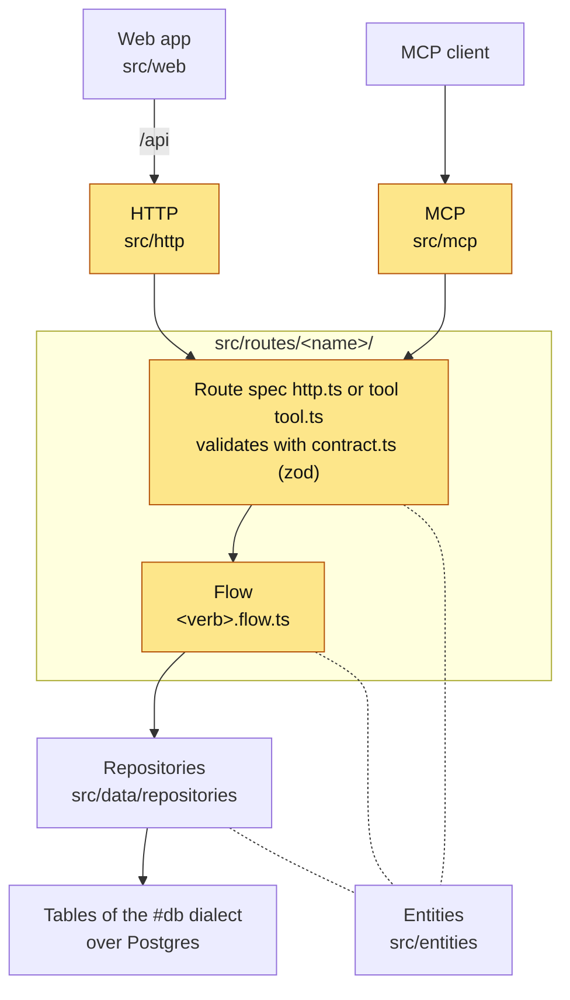
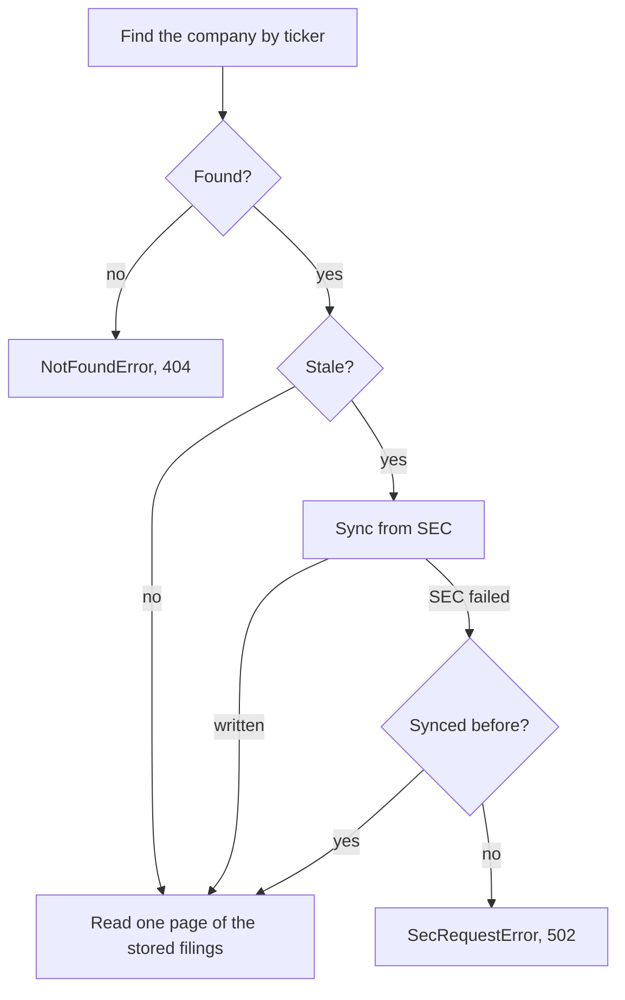
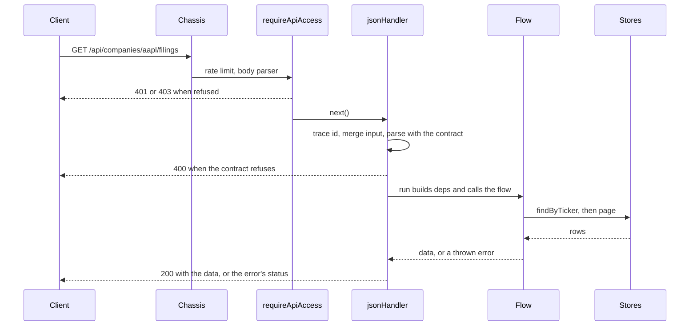
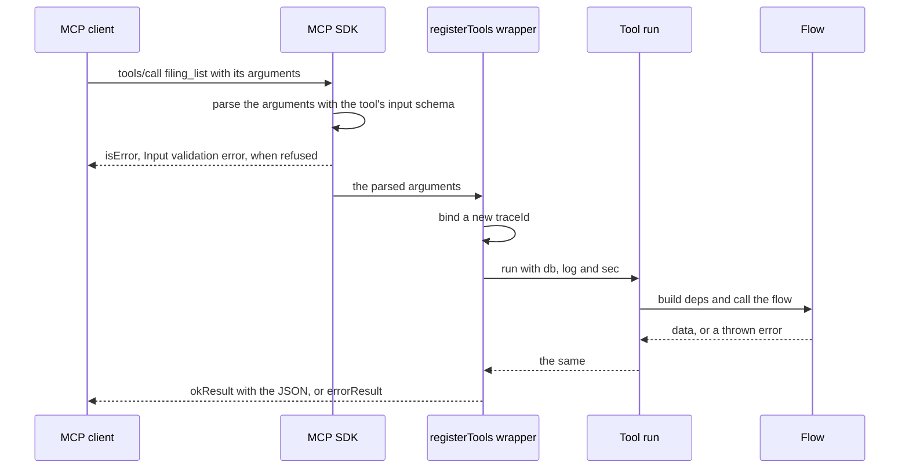

# Service layer

This page covers the service layer: the route folders under `src/routes/`, the HTTP server in
`src/http/` and the MCP server in `src/mcp/`. It follows one call from the server's start to its
answer, over HTTP and over MCP, and names the file that holds each step. The other two pages of
this guide are the [Data layer](data.md) and the [Web app](web.md).

## The layers

The highlighted boxes are this page. Calls go down the map and never up, and entities, the plain
zod schemas of the domain, are shared by every layer that touches the data.



The [backend map](../../CLAUDE.md#backend-map) in `CLAUDE.md` lists the same pieces, one line
each. [Auth](../auth.md), [MCP](../mcp.md) and [Documentation](../documentation.md) go deeper into
the credentials, the MCP server and the API docs.

## One folder per resource

Every resource the API serves is one folder, `src/routes/<name>/`. Its files split the work by
concern, so the same work is served over HTTP and over MCP without being written twice.

| File | What it holds | In `src/routes/info/` |
| --- | --- | --- |
| `contract.ts` | The strict zod schemas of the input and the output, and the log `DOMAIN` | `InfoInputSchema`, `ServiceInfoSchema` |
| `<verb>.flow.ts` | The work: one function over its parsed input and an injected `deps` | `getServiceInfo` in `get.flow.ts` |
| `http.ts` | One `route(...)` spec per HTTP route | `infoRoute` |
| `tool.ts` | One `defineTool(...)` per MCP tool | `infoTool` |
| `repository.ts` | The stores a flow's `deps` holds, built over a database client | none: `service_info` reads no table |

`service_info` (`src/routes/info/`) is the smallest example, and the one a new route copies. The
companies and filings folders, `src/routes/companies/` and `src/routes/filings/`, are the real
ones: they read tables and sync from SEC.

### The contract

A contract is what both surfaces parse with. Its schemas are strict (`z.strictObject`), which
means a field the schema does not name is refused rather than dropped.

```ts
// src/routes/info/contract.ts
export const InfoInputSchema = z.strictObject({});

export const ServiceInfoSchema = z.strictObject({
  id: z.string(),
  name: z.string(),
  version: z.string(),
  dialect: z.enum(['sqlite', 'pg']),
  notebook: z.boolean(),
});
```

The route and the tool import the very same input schema object, so they cannot disagree about
what a valid call is, and `tests/mcp/all-tools.test.ts` checks that by identity. One schema must
then read both surfaces: an HTTP path or query string
carries text, while an MCP call carries JSON numbers and booleans. So `src/routes/common.ts` holds
fields that take both, such as `IdSchema`, `booleanOrText` and the paging fields
`PaginationQuery`.

The real contracts build on those fields. `FilingListInput` adds the ticker from the path, an
optional form filter and a sort order to the paging fields:

```ts
// src/routes/filings/contract.ts
export const FilingListInput = PaginationQuery.extend({
  /** The ticker from the path, upper cased. */
  ticker: Ticker,
  /** The bucket to keep: a named base form, amendments included, or `other`; every form when absent. */
  form: FormBucket.optional(),
  /** The order of the filings, newest first by default. */
  sort: FilingSort.default('-filingDate'),
});
```

### The flow

A flow is the use case itself. It is a plain function of its parsed input and a `deps` object,
which holds everything the function reads: stores, clients, the clock and the log. Because the
caller hands those in, a test can pass fakes, and the flow never learns which surface called it.

```ts
// src/routes/info/get.flow.ts
export interface ServiceInfoDeps {
  readonly env: Record<string, string | undefined>
  readonly dialect: 'sqlite' | 'pg'
  readonly log: Log
}

export function getServiceInfo(_input: InfoInput, deps: ServiceInfoDeps): ServiceInfo {
  const log = scoped(deps.log, 'get');
  const notebook = readNotebookConfig(deps.env).kind === 'on';
  log.debug({ step: 'read', dialect: deps.dialect, notebook }, 'service info read');
  // ...returns the id, name, version, dialect and notebook flag
}
```

The flow binds its own log scope with `scoped` and returns plain data. For a failure the caller
should see, it throws a typed error from `src/errors.ts`, such as `NotFoundError`, and the
transports turn that error into a status ([the error envelope](#the-error-envelope)).

### The route spec

`route()` in `src/http/route.ts` builds a `RouteSpec`, a route described as data. It takes the
method, the path relative to `/api`, the name of the tool the route mirrors, the input schema, a
description for the API docs, and the `run` function.

```ts
// src/routes/info/http.ts
export const infoRoute = route('get', '/info', 'service_info', InfoInputSchema, {
  summary: 'The service id, name and version, its database dialect, and whether the Open Notebook tools are configured.',
  output: ServiceInfoSchema,
}, async (input, { log }) => getServiceInfo(input, { env: process.env, dialect: DIALECT, log: inDomain(log, DOMAIN) }));
```

`run` receives the parsed input and a context of `{ db, log, pathOnly, sec }`. From that context
it builds the flow's `deps`, binds the route's domain on the log, and logs nothing itself.
`pathOnly` holds path parameters that no input field names; no route uses it yet.

A path parameter is named after its schema field, `:ticker` for `ticker`, because the strict
schema would refuse any other name. `webRoute()` in the same file builds a route that mirrors no
tool, for a route only the web app needs; no route uses it yet either.

### The tool

`defineTool()` in `src/mcp/register.ts` builds a `ToolDefinition`, the one shape every tool
exports. Its `run` has the same form as the route's, with a context of `{ db, log, sec }`, so the
two transport files differ only in their wrapper.

```ts
// src/routes/info/tool.ts
export const infoTool: ToolDefinition = defineTool({
  name: 'service_info',
  title: 'Service info',
  description:
    'Returns the service id, name and version, the database dialect it runs on (sqlite or pg), ' +
    'and whether the Open Notebook tools are configured. Takes no arguments.',
  input: InfoInputSchema,
  annotations: { readOnlyHint: true, openWorldHint: false },
  run: async (input, { log }) => getServiceInfo(input, { env: process.env, dialect: DIALECT, log: inDomain(log, DOMAIN) }),
});
```

The `annotations` are hints a client may read, for example to decide whether a call needs the
user's approval.

### The two lists

A spec is served only once it is listed. `ROUTES` in `src/routes/http.ts` is what the HTTP server
mounts and what the API docs read, and `ALL_TOOLS` in `src/routes/tools.ts` is what the MCP server
registers:

```ts
// the route table and the tool list, from their two files
export const ROUTES: readonly RouteSpec[] = [infoRoute, ...companyRoutes, ...filingRoutes];
export const ALL_TOOLS: readonly ToolDefinition[] = [infoTool, ...companyTools, ...filingTools];
```

A route and its tool go into the two lists in the same change. The eight Open Notebook tools in
`src/routes/notebook/` are the one exception: they have no route, and `src/mcp/server.ts` adds
them beside `ALL_TOOLS` only when a notebook is configured and answers at start.

## Route and tool, side by side

The two transport files wrap one flow, so most of what differs between them is the surface. This
table compares the two over one call.

| | HTTP route, `http.ts` | MCP tool, `tool.ts` |
| --- | --- | --- |
| Built with | `route()` from `src/http/route.ts` | `defineTool()` from `src/mcp/register.ts` |
| Listed in | `ROUTES` in `src/routes/http.ts` | `ALL_TOOLS` in `src/routes/tools.ts` |
| Served by | `bun run serve`, under `/api` | `bun run mcp`, over stdio or HTTP |
| Who may call | A bearer (the `API_KEY` or an API token) or a session cookie | Whoever starts the process, or reaches its port |
| Input arrives as | Path, query and JSON body, merged into one object | One JSON object of arguments |
| Who parses it | `jsonHandler` in `src/http/handler.ts` | The MCP SDK, before the handler runs |
| A refused input | 400, `ValidationError`, naming the field | `isError: true`, with `Input validation error` |
| Trace id | The caller's valid `x-request-id`, else a new UUID, answered in `x-request-id` | A new UUID per call |
| Success | `{ success: true, data }` | One text block of JSON |
| Failure | `{ success: false, error: { name, message } }` and a status | `isError: true` and `{ "error": { name, message } }` |

## Where repositories meet a flow

A flow never imports a repository. Instead, its `deps` type names a store with only the methods
the flow calls, and the transport file builds that store. The builder lives in the route folder's
`repository.ts`, which wraps the shared repositories under `src/data/repositories/` over the `Db`,
the database client, that the transport was handed.

```ts
// src/routes/filings/http.ts
export const filingListRoute = route('get', '/companies/:ticker/filings', 'filing_list', FilingListInput, {
  summary: 'Lists the company with the ticker and one page of its filings, filtered by base form or `other` and sorted by filing date.',
  output: FilingListOutput,
}, async (input, { db, log, sec }) => listFilings(input, {
  companies: companyLookupStore(db),
  filings: filingStore(db),
  sync: syncSourcesFor(db, sec),
  log: inDomain(log, DOMAIN),
}));
```

`companyLookupStore(db)` and `filingStore(db)` come from `src/routes/filings/repository.ts`, and
each of their methods is one call into `src/data/repositories/companies.ts` or
`src/data/repositories/filings.ts`. `syncSourcesFor(db, sec)` adds what a sync writes through: the
SEC client, the header write, the filings insert and delete, and the clock. The tool in
`src/routes/filings/tool.ts` builds the same `deps` the same way.

### Sync on read

`filing_list` keeps a company's stored filings fresh as it reads them. `listFilings` in
`list.flow.ts` resolves the ticker, then hands the company to `syncIfStale` in `sync.flow.ts`. A
company is stale when it was never synced, or when its `filingsSyncedAt` is more than 24 hours old
(`SYNC_TTL_HOURS`).



A sync fetches the company's submissions document from SEC and keeps the filings of the last year.
It inserts the new ones, deletes the stored ones older than a year, and writes the company header
with `filingsSyncedAt` last. That order makes a sync that fails part way safe to retry, because
the company stays stale until the last write lands.

When SEC fails for a company synced before, the stored rows are served, and `filingsSyncedAt`
shows their age. Only a company never synced lets the failure through, as a 502.

The SEC client is built once at start and handed down as `sec`, so its spacing of 10 requests a
second (`src/sec/client.ts`) covers every route and tool. Without a client, `syncSourcesFor`
answers `undefined` and the flow reads the stored rows only, which is how the route tests mount it.
`company_update` with `selected: true` runs the same `syncIfStale` before it sets the flag, so a
company enters the summary with data.

## The life cycle of one HTTP request

### Server start

`bun run serve` builds the web app and runs `startService` in `src/http/server.ts`. It reads every
setting before it opens anything, so a wrong one stops the start with its own message: the SEC
User-Agent, the sign-in mode, the API key and the port. With neither `API_KEY` nor `AUTH_MODE`
set, it refuses to start, because nothing could open `/api`.

The chassis, `createService` from `@open-tomato/service-express`, brings the `/health` route, a
body parser, a rate limit of 1,000 requests a minute and an error handler. On top of it the
service mounts, in this order:

1. `/auth`, the sign-in routes of `authRouter`.
2. `requireApiAccess` on `/api`, the credential check.
3. `mountRoutes`, every spec in `ROUTES` under `/api`, with the API docs beside them.
4. The built web app, when `bun run build:web` has written it.

### One request

A request for one company's filings crosses five pieces before it reaches the database:



**Auth.** `requireApiAccess` in `src/auth/access.ts` reads the `Authorization: Bearer` header
first, which holds the `API_KEY` or a minted API token. Without that header, it looks for a live
session cookie. A write made with the cookie must also send `x-app-csrf: 1`, or the answer is a
403 ([the CSRF header](../auth.md#the-csrf-header)). Every other refusal is the same 401 body, so a
caller never learns which credential failed.

**Trace id.** `jsonHandler` in `src/http/handler.ts` gives every request a trace id, an id that
every log line of that request carries. It is the caller's `x-request-id` when that header is a
valid id, and a new UUID otherwise. The handler answers it in the `x-request-id` header, on
success and failure alike, and binds it as `traceId` on a child of the base log.

**Input.** The handler merges the path parameters, the query and the JSON body into one object, and
parses it with the contract's schema. A name the path holds may not also arrive in the query or
the body, so a body cannot change the id in the URL. A refusal is a 400 whose message names each
field, and the flow is never called.

<!-- eslint-skip -->
```ts
// GET /api/companies/aapl/filings?form=10-K&page=2, as the handler merges it
{ ticker: 'aapl', form: '10-K', page: '2' }
// and as FilingListInput parses it
{ page: 2, pageSize: 25, ticker: 'AAPL', form: '10-K', sort: '-filingDate' }
```

**Flow call.** The handler calls the spec's `run` with the parsed input and its context. `run`
builds the flow's `deps`, binds the domain on the log, and returns what the flow returns.

**Answer.** A value comes back as `{ success: true, data }`, with `null` for a flow that returns
nothing. The handler does not parse that value against the output schema at run time. The output
schema documents the answer in the API docs, and `tests/routes/stub-outputs.test.ts` checks that
the flow, the tool and the route each answer something it accepts.

### The error envelope

A thrown error becomes `{ success: false, error: { name, message } }`. `statusFor` in
`src/errors.ts` picks the status, and `describeError` picks the text. The MCP surface uses the same
`describeError`, so both surfaces word one failure the same way.

| Status | `error.name` | When |
| --- | --- | --- |
| 400 | `ValidationError` | The contract refused the input; the message names the field |
| 401 | `Unauthorized` | No credential was sent, or a wrong one |
| 403 | `Forbidden` | A signed-in browser sent a write without `x-app-csrf: 1` |
| 404 | `NotFoundError` | A thing the caller named does not exist, as in `company ZZZZ does not exist` |
| 409 | `ConflictError` | The request collides with a stored row |
| 500 | `InternalError` | Any other error; its detail goes to the log only |
| 502 | `SecRequestError` | SEC failed for a company never synced, so nothing stored can stand in |

An error outside the known classes is answered as `InternalError` with `internal error`, because
its message could hold a SQL statement or a connection string. A zod error thrown inside the work
is a 500 too: the input was parsed already, so that error came from inside the server. The handler
logs each 500 under domain `Http`, scope `handle` and step `respond`, with the request's trace id.

### Logging

Every line carries a breadcrumb of four fields, and a different layer binds each one:

| Field | Bound by | Example |
| --- | --- | --- |
| `traceId` | `jsonHandler`, or `registerTools` for a tool call | a UUID |
| `domain` | `http.ts` and `tool.ts`, with `inDomain(log, DOMAIN)` | `Filings` |
| `scope` | The flow's entry point, with `scoped(deps.log, 'list')` | `list` |
| `step` | The line's own context object | `read` |

`inDomain` and `scoped` in `src/logging.ts` each return a child log that adds one field to every
line. In a flow, a routine step logs at `debug`, and only the critical path logs at `info`:
`filings synced` in `sync.flow.ts` and `company selection set` in `update.flow.ts`. A flow never
logs an input body, a token or a password.

## The life cycle of one MCP tool call

### Server start

`bun run mcp` runs `src/mcp/server.ts`, a separate process from `bun run serve` that reads the same
`.env` and the same database. It picks the transport first, in `src/mcp/transport.ts`: unset or
`stdio` is stdio, the exact value `http` is HTTP, and any other value exits with 1. The check is
strict because the MCP package reads every other value as HTTP, which would open a port by typo.

The server then builds the SEC client, probes the Open Notebook when one is configured, and opens
the database. `createMCP` calls `setupMcp` in `src/mcp/setup.ts`, which hands `ALL_TOOLS` and any
notebook tools to `registerTools` in `src/mcp/register.ts`.

Nothing authenticates a tool call. Over stdio, whoever can start the process can call every tool,
and over HTTP, whoever reaches the port can. [MCP](../mcp.md) says how to keep that port private.

### One tool call

The same `filing_list` call, made by an agent, crosses three pieces before the flow:



The SDK validates the arguments against the tool's `input` schema before the handler runs, so
`run` only ever sees parsed input. The wrapper in `registerTools` then binds a fresh `traceId`, a
random UUID, on a child of the base log. Unlike over HTTP, a caller cannot choose that id.

The wrapper catches whatever the tool throws. `okResult` in `src/mcp/result.ts` wraps a value as
one text block of JSON. `errorResult` wraps an error as `isError: true` with
`{ "error": { name, message } }`, the text `describeError` gives, so it matches the HTTP envelope.

Over stdio, stdout carries the protocol, so the package's logger writes every line to stderr. That
is why tool code logs on the `log` it is handed and never on a logger of its own
([logs and trace ids](../mcp.md#logs-and-trace-ids)).

## API docs from the same specs

The OpenAPI document is read from `ROUTES`, so a route is documented by being listed.
`buildOpenApiDocument` in `src/http/openapi.ts` turns each `RouteSpec` into one operation:

- The path is `/api` plus the route's path, with `:ticker` spelled `{ticker}`.
- The schema fields the path names are path parameters. The other fields are the query on a GET
  or a DELETE, and the JSON body otherwise.
- The 200 holds `{ success: true, data }` with the contract's `output` schema. The 400, 401, 403
  (writes only) and 500 hold the error envelope.
- The summary comes from the route's description, and the tag from the path's first segment.

`serviceDocument` in `src/routes/http.ts` adds the routes outside the table: `GET /health`, the
`/auth` routes of the running `AUTH_MODE` from `src/auth/openapi.ts`, and the two docs routes.
`mountRoutes` builds the document once, at start, and serves it behind the same credential check
as the routes it describes:

- `GET /api/openapi.json` answers the document as JSON.
- `GET /api/docs` answers a Swagger UI page that reads it.

A route that cannot be documented stops the start, and the message names its method and path.
That is a route whose input is not an object schema, or whose path holds an optional segment or a
wildcard. `bun run docs:openapi` writes the same document to a file for offline tools, and
[how a route documents itself](../documentation.md#how-a-route-documents-itself) has the full
table.

## Import rules

The lines between the layers are an ESLint rule, `template/layer-imports`, in
`eslint/rules/layer-imports.mjs` and registered by `eslint/plugin.mjs`. It runs in `bun run lint`
and in the editor, and it reports the exact import that crosses a line. A test was rejected for
this job, because a test reads text with regexes and runs only in `bun test`.

| Files | May not import |
| --- | --- |
| A flow, `<verb>.flow.ts` | `src/http`, `src/mcp`, any `http.ts` or `tool.ts`, anything under `src/data`, `#db`, `drizzle-orm` or a `repository.ts`; from `src/logging.ts` only `scoped` and the type `Log` |
| A route file, `src/routes/<name>/http.ts` | `src/mcp` or a `tool.ts` |
| A tool file, `tool.ts` | `src/http` or an `http.ts` |
| Anything in `src/http` | `src/mcp` |
| Anything in `src/mcp` | `src/http` |
| An entity, in `src/entities` | anything but `zod` and other entities |

The rule leaves the rest open, and the real flows use that room. The companies `update.flow.ts`
imports `syncIfStale` from the filings `sync.flow.ts`, and `sync.flow.ts` imports the SEC parsing
from `src/sec/parse.ts`. The SEC client itself still arrives through `deps`, so a test can hand
the flow a stub.

A second local rule, `template/no-drizzle-transaction`, keeps drizzle's `transaction` call inside
`transact` in `src/data/pg/transaction.ts`. `tests/eslint/layer-imports.test.ts` tests the first
rule.

## Tests for each piece

Each route folder has a test folder of the same name, `tests/routes/<name>/`, and
`tests/routes/info/` sets the pattern:

| Test | Runs through | Checks |
| --- | --- | --- |
| `<verb>.flow.test.ts` | The flow, with fake stores and `captureLog()` | The work and its log lines, with no database |
| `http.test.ts` | `startTestServer` from `tests/http/harness.ts` | Status codes, the envelope, the `DOMAIN` on the flow's line |
| `tool.test.ts` | `connectTools` from `tests/support/tool-harness.ts` | The same call over a real MCP client and server |
| `repository.test.ts` | A seeded SQLite test database | The stores over real queries |

The filings sync tests use `fake-sync.ts` in `tests/routes/filings/`, an SEC client and stores
that record every call with no database. A few tests read the lists themselves, so a new route is
covered as soon as it is listed:

- `tests/http/routes.test.ts` sends every route in `ROUTES` a stray field and expects a 400.
- `tests/http/openapi.test.ts` finds every route in `ROUTES` as one operation of the document.
- `tests/mcp/all-tools.test.ts` checks that each route and its tool share one schema object.
- `tests/routes/stub-outputs.test.ts` parses the companies and filings answers with their output
  schemas.

## Next step: add a route

`/be create-route <entity>` writes a new resource folder the way this page describes: its
contract, flows, repository, routes, MCP tools and tests. It asks eight questions first, from the
name and the methods to whether a route is for the web app only, and writes nothing until they are
answered. Its files are in `.claude/skills/be/`, and [Skills](../skills.md) lists every project
skill.

A route over a new table needs that table first, from `/db add <table>`, which the
[Data layer](data.md) page covers. After either, run the gates in the order
[`CLAUDE.md`](../../CLAUDE.md) gives, starting with `bun run lint` and `bun run typecheck`.
