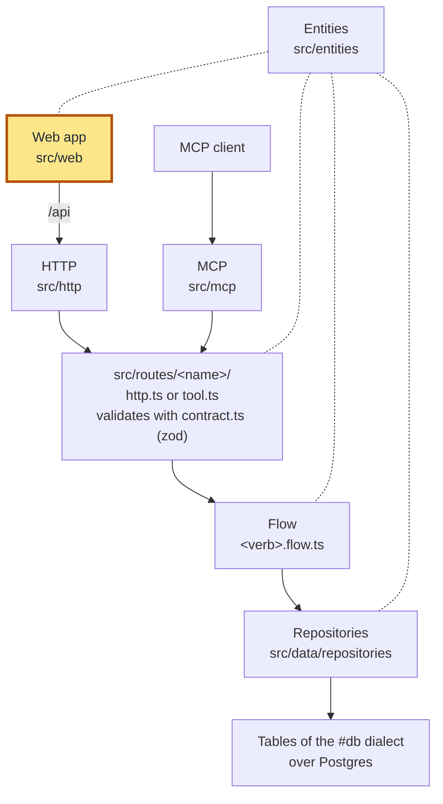
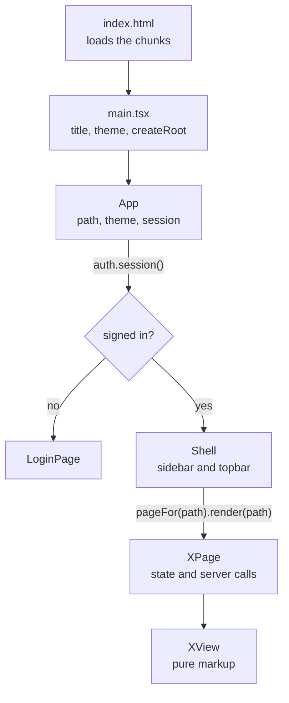
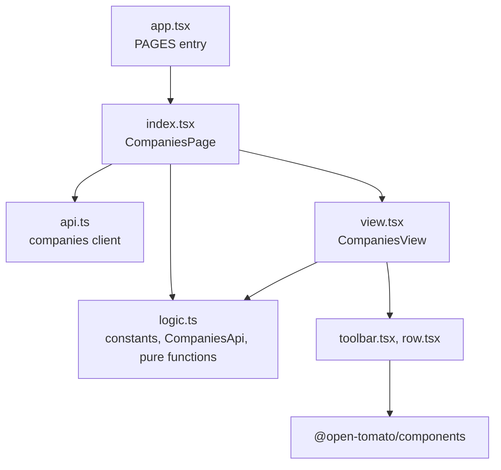
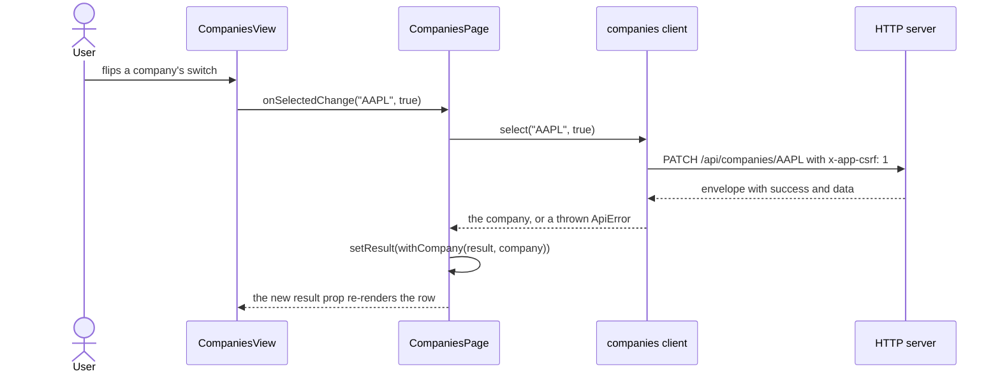

# Web app

This page walks through the web app under `src/web/`, a React 19 single-page app that a person
uses in a browser. It covers how the app boots, how pages and paths are defined, how a page is
split into files, how it talks to the backend, and how it is built, served and tested.



The highlighted box is this page. The web app reaches the backend only over HTTP, so it never
imports a flow, a repository or a table. It does import types from the route contracts and the
entities, which is how the two sides agree on a shape. The sign-in calls go to `/auth` rather
than `/api`; the same HTTP server answers both, and [auth](../auth.md) describes `/auth`.

The backend has two sibling pages: the [Data layer](data.md) covers tables, migrations and
repositories, and the [Service layer](service.md) covers routes, contracts, flows and MCP tools.
For the setup steps, see [the web app page](../web.md); for the component library's rules, see
[the web README](../../src/web/README.md).

## The layers inside the web app

The web app has its own small set of layers, and each one has one concern. The outer layers hold
state and talk to the server; the inner ones only turn props into markup. The table lists them
from the outside in.

| Layer | Where | Concerned with | Calls |
| --- | --- | --- | --- |
| Entry | `src/web/main.tsx` | Mounting React once, setting the theme before the first paint | `App` |
| Shell | `src/web/app.tsx` | The sign-in gate, the frame (sidebar, topbar) and the `PAGES` table | `auth`, a page's `XPage` |
| Page | `src/web/pages/<name>/index.tsx` | State, effects and server calls for one screen | the client, `logic.ts`, `XView` |
| View | `view.tsx` and its part files | Turning props into markup; no state, no server | part files, the library |
| Logic | `logic.ts` | Constants, the page's API interface and pure functions; no JSX | types from `src/web/api.ts` |
| Client | `src/web/api.ts` | Paths, `fetch`, the CSRF header, the response envelope | `/api` and `/auth` over HTTP |
| Library | `@open-tomato/components`, `src/web/components/ports/` | Every control, styled by variants | nothing in the app |

The direction matters more than the names. A view imports the client's types and never its
values, so a view cannot start a request. In the code as it stands, the client's values are
imported only by the shell, the `index.tsx` files of pages and components, the one-file pages,
and `src/web/pages/filings/logic.ts`. This is a convention, because the `template/layer-imports`
lint rule covers the backend folders only.

## Boot and life cycle

The browser loads `index.html`, which loads one script and one stylesheet. From there each step
hands control to the next, and the session check decides which screen comes up.



### The entry

`src/web/main.tsx` runs once per page load. It sets the browser title from `APP.name` in
`src/app-config.ts`, applies the stored theme, and mounts `App` into `#root`:

```tsx
// src/web/main.tsx
document.title = APP.name;
applyStoredTheme();

const root = document.getElementById('root');
if (root) {
  createRoot(root).render(
    <StrictMode>
      <App />
    </StrictMode>,
  );
}
```

The theme comes first because it must be on the page before anything paints. `applyStoredTheme`
in `src/web/theme.ts` sets `data-theme` on the root element, which the library's tokens read. It
uses the choice stored in `localStorage` under `theme`, or `light` when nothing is stored, so the
OS setting is never read.

### The sign-in gate

`App` in `src/web/app.tsx` holds three things: the browser's path, the theme, and the session.
On mount it asks `auth.session()` whether this browser is signed in, and until the answer comes
it draws nothing, because the same-origin call answers in milliseconds.

The answer picks the screen. A failed call shows a red `Banner` with the message. A browser that
is not signed in gets `LoginPage` from `src/web/pages/login.tsx`, which signs in and then calls
`onSignedIn`. `App` then moves to the landing page and asks for the session again, so the shell
appears without a page load. Sign-out runs the same loop backwards, through `auth.logout()` and
`/login`.

### The shell

A signed-in browser gets `Shell`, the frame every page sits in. The sidebar holds the brand and a
`SidebarNav` built from `PAGES`. The topbar holds the page's label as the screen's one `h1`, the
company search, the theme switch and the sign-out button:

```tsx
// src/web/app.tsx
<Topbar
  sidebarCollapsed={collapsed}
  onToggleSidebar={() => setCollapsed((was) => !was)}
>
  <AppShellTitle>{current.label}</AppShellTitle>
  <CompanySearch onPick={(cik) => onNavigate(filingsPathOf(cik))} />
  <ThemeSwitcher theme={theme} onToggle={onThemeChange} />
  <Button variant="ghost" size="sm" onClick={onSignOut}>
    Sign out
  </Button>
</Topbar>;
```

Because the shell draws the heading, a page draws none of its own. `tests/web/pages.test.tsx`
fails for a page that renders an `h1`. The theme switch calls `setTheme` from `useTheme`, which
sets `data-theme` and stores the choice for the next visit.

## Pages and paths

### The `PAGES` table

`PAGES` in `src/web/app.tsx` is the one list of the pages behind the sign-in, in nav order. Each
entry is an `AppPage`: a path, a nav label, a Lucide icon name, and a `render` function that
draws the page for the browser's path.

```tsx
// src/web/app.tsx
export interface AppPage {
  readonly path: string
  readonly label: string
  readonly icon: IconName
  readonly render: (path: string) => ReactNode
}

export function pageFor(path: string): AppPage {
  const first = PAGES[0];
  if (!first) throw new Error('the app has no pages');
  return PAGES.find((page) => drawsPath(page, path)) ?? first;
}
```

The first entry is the landing page, and its path and label come from `APP.landing`, so `/`
lands on `/summary`. `pageFor` falls back to that first entry for a path no page draws, and `App`
then rewrites the address bar to the landing path with `history.replaceState`.

### Moving between pages

The app has no router library. `src/web/router.ts` holds two small pieces: `navigate`, which
pushes a path onto the history, and `usePath`, a hook that re-renders on every `popstate`.

```ts
// src/web/router.ts
export function navigate(path: string): void {
  window.history.pushState(null, '', path);
  window.dispatchEvent(new PopStateEvent('popstate'));
}
```

`navigate` fires the event itself, because `pushState` fires none. The back and forward buttons
fire it too, so `usePath` follows them with no extra code.

### A path with a parameter

A page draws its own path and every path under it, which `drawsPath` checks. So `/filings/320193`
belongs to the `/filings` page, and its `render` receives the whole path:

```tsx
// src/web/app.tsx
export const PAGES: readonly AppPage[] = [
  { path: APP.landing.path, label: APP.landing.label, icon: 'chart-column-stacked', render: () => <SummaryPage /> },
  {
    path: FILINGS_PATH,
    label: FILINGS_TITLE,
    icon: 'file-text',
    render: (path) => {
      const cik = cikFromPath(path);
      return <FilingsPage key={cik ?? 'none'} cik={cik} />;
    },
  },
  // …the Companies and Tokens entries
];
```

`cikFromPath` in `src/web/pages/filings/logic.ts` reads the CIK, the number SEC gives a company,
with a digits-only pattern, so `/filings/abc` names no company. The `key` mounts a fresh page for
each CIK, which means a new company starts with no filter. `filingsPathOf` builds the path the
other way, and the company search uses it when a person picks a company.

### The server side: `APP_PATHS`

The browser routes on its own, but a reload asks the server for the path. `APP_PATHS` in
`src/http/server.ts` lists every path the server answers with `index.html`:

```ts
// src/http/server.ts
export const APP_PATHS = ['/', '/login', APP.landing.path, '/filings', '/filings/:cik', '/companies', '/tokens'];
```

`/filings/:cik` is an Express path pattern, so one entry covers every CIK. A page in `PAGES`
whose path is missing here opens from the nav but answers 404 on a reload.

### Adding a page with `/fe empty-page`

The project skill `/fe empty-page <name>`, from `.claude/skills/fe/`, adds a page in one call.
It asks for the nav label and the icon, shows the files it will write, and waits for a yes. Then
it writes all four places a page touches:

1. `src/web/pages/<name>.tsx`, with a pure view and a page that renders it.
2. An entry in `PAGES`, after the landing entry.
3. `'/<name>'` in `APP_PATHS`.
4. `tests/web/<name>.test.tsx`, and the two pinned lists in `tests/http/server.test.ts` and
   `tests/web/pages.test.tsx`.

The new page is one file with an empty state. When it grows, it becomes a folder, as the next
section shows. [The web app page](../web.md#add-a-page-with-fe-empty-page) has a worked example.

## Inside a page folder

A page with more than a view and its state is a folder, `src/web/pages/<name>/`. Each file in it
has one concern. `src/web/app.tsx` mounts the page from `index.tsx`, and takes from `logic.ts`
only what its `PAGES` entry needs, such as `COMPANIES_TITLE`.

| File | Holds | Imports | Tested by |
| --- | --- | --- | --- |
| `index.tsx` | `XPage`: `useState`, `useEffect`, the server calls, the handlers | the client, `logic.ts`, `view.tsx` | the page with a stub API |
| `view.tsx` | `XView`: a pure function of its props | the part files, `logic.ts`, the library | `renderToStaticMarkup` |
| `logic.ts` | Constants, the page's API interface, pure functions; no JSX | types from `src/web/api.ts` | plain unit tests |
| Part files | One piece of the view each, such as `toolbar.tsx`, `row.tsx`, `table.tsx` | `logic.ts`, the library | `renderToStaticMarkup` |

The Companies page shows the import arrows. They all point inwards, and only the page reaches the
client:



### The page: state and server calls

`CompaniesPage` takes its server access as a prop, `api = companies`, so the real client is the
default and a test passes a stand-in. It holds the search text, the query the text debounces
into, the last answer and the last error. An effect fetches whenever the query changes:

```tsx
// src/web/pages/companies/index.tsx
useEffect(() => {
  let stale = false;
  void api.list(query).then(
    (next) => {
      if (stale) return;
      setResult(next);
      setError(undefined);
    },
    (failure: unknown) => {
      if (!stale) setError(messageOf(failure, 'could not load the companies'));
    },
  );
  return () => {
    stale = true;
  };
}, [api, query]);
```

The `stale` flag drops an answer that arrives after a newer query was sent, so a slow answer
never overwrites a fresh one. The Filings and Summary pages, the filings dialog and the company
search use the same pattern. A failure becomes a message through `messageOf` in
`src/web/api.ts`, which the pages share.

### The view: props in, markup out

`CompaniesView` in `view.tsx` holds no state and calls no server. It composes the toolbar, an
alert when the last call failed, one `CompanyRow` per company, and the library's `EmptyState`
when there are none. Because it is a plain function of its props, a test renders it with fixed
data and reads the HTML.

### The logic: constants and pure functions

`logic.ts` holds what the page and the view share, with no JSX: labels, page sizes, the
`CompaniesApi` interface the page needs, and the pure functions that compute the next state. For
example, `withSearch` builds the next query from typed text:

```ts
// src/web/pages/companies/logic.ts
export function withSearch(query: CompanyQuery, text: string): CompanyQuery {
  const q = text.trim();
  return q === query.q
    ? query
    : { ...query, q, page: 1 };
}
```

It returns a new object and never edits the old one. When the trimmed text is unchanged, it
returns the same object, so React sees no change and the effect does not fetch again.

### The other pages

The Filings and Summary pages follow the same split, each with its own parts:

- `src/web/pages/filings/`: `logic.ts` holds `cikFromPath`, `FILINGS_PAGE_API`, which composes
  the companies and filings clients, and `loadCompanyFilings(api, cik)`, which takes the API as a
  parameter. `table.tsx` holds the table's columns, and `toolbar.tsx` the form filter.
- `src/web/pages/summary/`: `logic.ts` holds `summaryStats` and `withoutCompany`, and the view
  composes `stat-cards.tsx`, `table.tsx` and `chart.tsx`, the chart drawn by
  `@open-tomato/charts`.
- `src/web/pages/tokens.tsx` and `src/web/pages/login.tsx` are one file each, because each is
  only the page and its view.

The Filings page also reuses `CompanyRow` from the Companies folder for the company's card.

### Shared components

A piece that opens over a page, or that several screens use, sits in `src/web/components/`. A
folder there is split the same way as a page folder:

- `filings/`: the filings drawer and modal. `FilingsDialog` in `index.tsx` holds the state and
  the fetch, `FilingsView` in `view.tsx` picks the `Drawer` or the `Modal`, and `panel.tsx`,
  `accordion.tsx` and `grid.tsx` draw the content. `logic.ts` holds `loadFilings`, which reads
  every page of a company's filings, and the form buckets.
- `company-search/`: `CompanySearch`, the topbar's search over `GET /api/companies`, with the
  same debounce and stale-answer pattern. `focusCompanySearch` in its `logic.ts` focuses it from
  anywhere by sending its own keyboard shortcut.
- `pager.tsx`: `Pager`, the Companies toolbar's pages counted from 1, and `pageCountOf`, over the
  local `Pagination` port.

The Companies and Summary pages both open `FilingsDialog` when a person clicks a company's name,
and each passes the dialog its own `filingsApi` prop, so a test can stub that call too.

## Talking to the backend

### The client in `src/web/api.ts`

`src/web/api.ts` is the only file that calls `fetch`. It has one generic function, `request`, and
one small client per area built on it.

`request` sends a same-origin JSON call and unwraps the response envelope, the
`{ success, data }` or `{ success, error }` object every route answers with. A write also sends
the `x-app-csrf: 1` header, which [auth](../auth.md#the-csrf-header) explains:

<!-- eslint-skip -->
```ts
// src/web/api.ts
export async function request<T>(method: string, path: string, body?: unknown, fetchImpl: typeof fetch = fetch): Promise<T> {
  const response = await fetchImpl(path, {
    method,
    credentials: 'same-origin',
    headers: {
      accept: 'application/json',
      ...(method === 'GET'
        ? {}
        : CSRF_HEADERS),
      // …content-type when there is a body
    },
    // …the JSON body when there is one
  });
  // …returns the envelope's data, or throws an ApiError
}
```

A refusal becomes an `ApiError`, which carries the status, the error's name and its message.
Because the session cookie rides on every same-origin call, the client sends no token of its own.

Each area gets a factory that takes a `fetch`, plus a default instance over the browser's own:
`auth`, `companies`, `filings` and `summary`. The factory is what lets a test hand in a stand-in:

```ts
// src/web/api.ts
export function createCompaniesClient(fetchImpl: typeof fetch) {
  return {
    list: (query: CompanyQuery): Promise<CompanyPage> => request('GET', companiesPath(query), undefined, fetchImpl),
    select: (ticker: string, selected: CompanyUpdateInput['selected']): Promise<Company> => {
      const body = { selected } satisfies Pick<CompanyUpdateInput, 'selected'>;
      return request('PATCH', companyPath(ticker), body, fetchImpl);
    },
  };
}

export const companies = createCompaniesClient(fetch);
```

The paths have their own builders, `companiesPath`, `companyPath`, `filingsPath` and
`summaryPath`. Each one encodes what goes in the URL, so the pages never build a query string.

### Types, schemas and what is trusted

The shapes come from the backend's contracts, the zod schemas each route validates with. The
client imports their inferred types with `import type`, so the bundle carries no zod:

<!-- eslint-skip -->
```ts
// src/web/api.ts
import type { CompanyListOutput, CompanyUpdateInput, CompanyUpdateOutput } from '../routes/companies/contract.ts';

export type CompanyPage = CompanyListOutput;
export type Company = CompanyUpdateOutput;
```

So a contract change that breaks the web app fails `bun run typecheck`. The other contracts it
reads are `src/routes/filings/contract.ts` and `src/auth/contract.ts`, and `FormBucket` comes
from the entity in `src/entities/filing.ts`.

Validation happens on the server, and the browser trusts the answer. The server parses every
input against the route's strict schema. The client reads a response as its type, with no
runtime parse, because the same contract typed both sides. It still shapes what it sends, so the
server does not refuse it:

- A blank search is left out of the query, because the route refuses an empty `q`.
- `selected` is sent only as `true`, and a switch sends an explicit boolean, never a toggle.
- A ticker is encoded with `encodeURIComponent`, so a `/` in it stays in one path segment.
- The `satisfies` checks hold each request body to its contract's input type at compile time.

A few values are mirrored on the web side to keep zod out of the bundle. `FORM_BUCKETS` in
`src/web/components/filings/logic.ts` mirrors the entity's list, and `tests/web/filings.test.tsx`
holds the two equal. `SUMMARY_PAGE_SIZE` repeats the routes' largest page size.

### One request, end to end

The Companies page's switch shows the whole round trip. The view only reports the click, the
page owns the call, and the server's answer replaces the row:



A refusal takes the other branch of the same `then`: the page sets `error`, and the view shows it
in a `Banner` above the rows it still holds.

## The component library

Every control comes from `@open-tomato/components`, a React component library pinned to
`0.2.0` in `package.json`. A library component takes variants and flags only, such as
`<Button variant="ghost" size="sm">` or `<AppShell viewport>`, and never a class string. Read
the library's story for a component before composing it; [the web README](../../src/web/README.md)
says where the stories live.

The rule has one exception in the tree. The filings modal passes one class string to the
library's `Modal` to fill the screen, because its sizes stop at 620 pixels, and
`src/web/components/filings/view.tsx` explains it. A plain HTML element in the app may still
carry a few Tailwind classes.

### Ports

A port is a local copy of a library component with one fix, kept in
`src/web/components/ports/` until the library takes the fix and the copy is deleted. Each file
names the library version it copies and the one change it makes:

- `pagination.tsx`, over `page-slots.ts`: the library's `Pagination` with windowing, so 321
  pages of companies draw a handful of buttons rather than 321.
- `topbar.tsx`: the library's `AppShellTopbar` lifted onto its own layer, so the company
  search's list opens over the page and not under it.

The app imports the port in place of the library's component, as `Shell` does with `Topbar`.
[The Ports section](../../src/web/README.md#ports) of the web README has the full reasons.

### Styles

`src/web/styles.css` is the one stylesheet, the entry Tailwind 4 compiles. It imports Tailwind and
the library's stylesheet, points Tailwind's scan at `@open-tomato/charts`, and defines the theme
tokens the charts read. No other hand-written CSS belongs there, so a layout fix starts with the
page's composition.

## Build and serve

### The build

`bun run build:web` runs `scripts/build-web.ts`, which bundles `src/web/index.html` and every
file it pulls in with `Bun.build`, Bun's own bundler. The CSS goes through `bun-plugin-tailwind`:

```ts
// scripts/build-web.ts
const PUBLIC_PATH = '/';

export async function buildWeb(options: BuildWebOptions): Promise<BuildOutput> {
  return Bun.build({
    entrypoints: options.entrypoints ?? [WEB_ENTRY],
    outdir: options.outdir,
    publicPath: PUBLIC_PATH,
    minify: true,
    sourcemap: options.sourcemap ?? 'none',
    plugins: [tailwindHoistingImports],
    throw: false,
  });
}
```

`publicPath: '/'` makes `index.html` load its chunks from the root, as `/chunk-….js`. A chunk
named relative to the page would be asked for as `/filings/chunk-….js` on a Filings path, and the
server would answer that with `index.html`. The plugin is wrapped by `tailwindHoistingImports`,
which moves the library's remote font `@import` to the top, because Bun's CSS parser rejects it
anywhere else.

The output is `index.html` and two chunks in `src/web/dist/`, which git ignores. The build empties
that folder first, so no old chunk stays beside a new one. A failed build prints its messages and
`build:web failed`, then exits 1.

### Serving it

`bun run serve` runs the build, then starts the service from `src/http/server.ts`. At start, the
service checks once for the bundle folder, and serves it beside the API when it is there:

```ts
// src/http/server.ts
if (existsSync(webDist)) {
  app.use(express.static(webDist));
  app.get(APP_PATHS, (_req, res) => res.sendFile('index.html', { root: webDist }));
} else {
  log.info({ step: 'serveWeb', webDist: 'absent' }, 'no web bundle found; serving the API only');
}
```

The static files and `APP_PATHS` share one origin with `/api` and `/auth`, so the browser needs
no CORS setup. Only the folder's presence is checked at start; each file is read from disk on
every request, so a rebuild shows on the next reload. `bun run dev` uses that: it rebuilds the
app on every change under `src/` and restarts the service on a backend change, so a page reload
is all an edit needs. [The web build](../setup.md#the-web-build) in the setup page has the
steps.

## Tests

The web tests live in `tests/web/`, mostly one file per page or shared component, such as
`companies.test.tsx`, `filings-page.test.tsx` and `company-search.test.tsx`. They run with no
browser and no DOM, because the split above makes most of the app plain functions.

A view is rendered to an HTML string with `renderToStaticMarkup` from `react-dom/server`, and
the test reads the string:

```tsx
// tests/web/summary.test.tsx
test('leaves its title to the topbar and renders its empty state', () => {
  const html = renderToStaticMarkup(<SummaryView />);
  expect(html).not.toContain('<h1');
  expect(pageFor('/summary').label).toBe(SUMMARY_TITLE);
  expect(html).toContain(SUMMARY_EMPTY_TITLE);
  expect(html).toContain(SUMMARY_EMPTY_DESCRIPTION);
});
```

A page is tested through its `api` prop. The test passes a stub, or a real client over a
recording `fetch`, and drives the page with `settle` from `tests/web/settle.tsx`. `settle` runs
the page's hooks with no DOM: it renders, runs the effects, lets their promises settle, and
renders again until nothing changes:

```tsx
// tests/web/companies.test.tsx
test('an API error shows a message and not the empty list', async () => {
  const { fetchImpl, calls } = recordingFetch({ success: false, error: { name: 'Boom', message: 'the registry is down' } }, 503);
  const { tree, stop } = await settle(<CompaniesPage api={createCompaniesClient(fetchImpl)} />);
  stop();
  expect(calls).toEqual(['GET /api/companies?page=1&pageSize=25']);
  const html = renderToStaticMarkup(tree);
  expect(html).toContain('role="alert"');
  expect(html).toContain('the registry is down');
  expect(html).not.toContain(COMPANIES_EMPTY_TITLE);
});
```

Because `settle` keeps the page's tree of unrendered elements, a test can also call a handler
prop directly, such as the view's `onOpenFilings`, then flush and read the next tree. The same
idea covers the overlays: the library's `Drawer` and `Modal` render nothing without a DOM, so
the filings tests render the pure `FilingsPanel` on its own, and call `FilingsView` as a plain
function to read which overlay it returns.

Beside the pages, `api.test.ts` pins the client's paths and headers, and `build.test.ts` builds
the bundle and checks it holds one copy of React.

Run them with `bun test tests/web`, after `bun run typecheck` and `bun run lint`.
